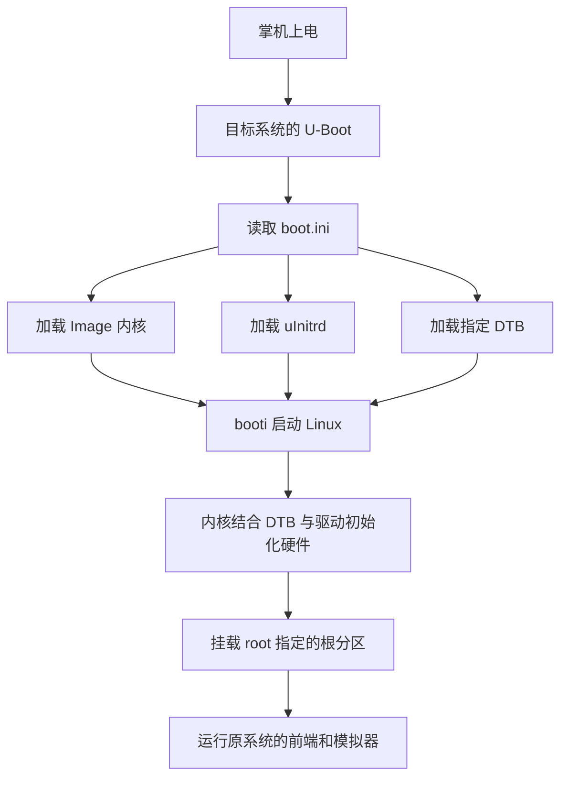
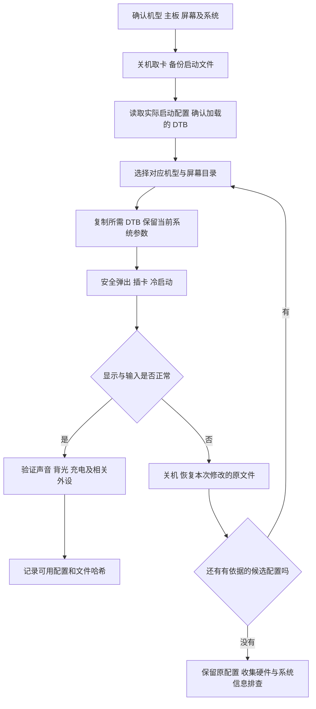

# R36S-DTB 项目功能与使用指南

本文基于本地仓库基线 `c2cceda` 的 README、全部 9 份 DTS、10 份 `boot.ini` 及二进制资产整理。它说明仓库实际提供的内容；硬件兼容性仍需对应掌机验证。

## 1. 项目解决什么问题

R36S-DTB 为采用 Rockchip RK3326 平台的掌机提供设备树配置。主要用途是在已有 Linux 掌机系统上适配不同屏幕、主板和输入硬件，并提供原 README 所述的 FN 功能键支持方案。

Linux 内核需要知道屏幕初始化命令、GPIO 接线、按键事件码、电源、存储和音频等硬件信息。设备树负责描述这些信息，内核中的对应驱动负责实现功能。

这个仓库的交付物是硬件适配文件。安装前需要已有适用于目标设备的完整系统；仓库不包含完整系统镜像、模拟器源码、游戏资源或刷机程序。

### 核心文件概念

| 文件 | 用途 | 普通用户是否需要修改 |
| --- | --- | --- |
| `.dts` | 可阅读、可修改的设备树文本源码 | 通常不需要；维护硬件适配时修改 |
| `.dtb` | 编译后的设备树，启动时交给内核 | 选择正确版本并复制到系统实际加载的位置 |
| `boot.ini` | U-Boot 启动配置，指定内核、initrd、DTB 和根分区参数 | 仅在系统使用该文件且需要切换 DTB 时调整 |
| `Image` | Linux 内核二进制，只有 Panel 5/6 目录附带 | 仅在明确匹配系统和模块时考虑更换 |
| `uInitrd` | 启动配置加载的初始内存盘 | 本仓库未提供，由目标系统提供 |
| `.dtb.orig`、`.dtb.tony` | 保留的设备树变体 | 不会因扩展名自动生效，先核对启动配置和用途 |

## 2. 仓库结构和配置选择

```text
R36S-DTB/
├── README.md
├── AGENTS.md                  代理工作与维护规则（默认文件名）
├── DTS/                       9 份设备树源码
│   ├── Panel0.dts ... Panel5.dts
│   ├── Panel4-V22.dts
│   ├── R46H.dts
│   └── RGB20S.dts
├── R36S/
│   ├── Panel 0/ ... Panel 4/
│   ├── Panel 4 - V22/
│   ├── Panel 5/                含额外 Image 和 rg351p-kernel.dtb
│   └── Panel 6/                含额外 Image；没有同名 DTS
├── R46H/
├── RGB20S/
└── docs/
    ├── PROJECT_GUIDE.zh-CN.md
    └── diagrams/              可独立导出的 Mermaid 源码
```

### 2.1 源码与主要发布文件

下表列出按目录命名及主要配置建立的对应关系，不代表已验证每个历史二进制都可由同名源码逐字节重建。

| 设备/配置目录 | 源码 | 仓库 `boot.ini` 加载的 DTB | 源码中的显示有效区域 |
| --- | --- | --- | --- |
| `R36S/Panel 0/` | `DTS/Panel0.dts` | `rk3326-r35s-linux.dtb` | 640 × 480 |
| `R36S/Panel 1/` | `DTS/Panel1.dts` | `rk3326-r35s-linux.dtb` | 640 × 480 |
| `R36S/Panel 2/` | `DTS/Panel2.dts` | `rk3326-r35s-linux.dtb` | 640 × 480 |
| `R36S/Panel 3/` | `DTS/Panel3.dts` | `rk3326-r35s-linux.dtb` | 640 × 480 |
| `R36S/Panel 4/` | `DTS/Panel4.dts` | `rk3326-r35s-linux.dtb` | 640 × 480 |
| `R36S/Panel 4 - V22/` | `DTS/Panel4-V22.dts` | `rk3326-r35s-linux.dtb` | 640 × 480 |
| `R36S/Panel 5/` | `DTS/Panel5.dts` | `rk3326-r35s-linux.dtb` | 640 × 480 |
| `R36S/Panel 6/` | 未提供 `Panel6.dts` | `rk3326-r35s-linux.dtb` | 主 DTB 检查为 640 × 480 |
| `R46H/` | `DTS/R46H.dts` | `rk3326-r46h-linux.dtb` | 1024 × 768 |
| `RGB20S/` | `DTS/RGB20S.dts` | `rk3326-rgb20s-linux.dtb` | 640 × 480 |

原 README 提及 R35S、R36S、R33S、R30S/O30S，以及 AmberELEC、ArkOS。源码和目录并未给出完整的“机型 × 主板 × 屏幕 × 系统版本”实测矩阵，因此不能据此保证同名设备或所有发行版版本都可使用。

### 2.2 选择时容易误解的地方

- Panel 0–6 是仓库的屏幕配置编号，另外有 V22 专用配置；编号不代表性能等级，也没有自动识别程序。
- `Panel 4 - V22` 除屏幕参数外，还为 USB 节点增加了 `vbus-supply` 和 `vcc_host` 电源节点。它与普通 Panel 4 有硬件配置差异。
- 部分源码的 `model` 保留 `Hardkernel ODROID-GO3` 或通用名称，不能用这个字符串单独鉴定掌机型号。
- 当前仓库中，Panel 0–4、V22 和 RGB20S 下的 `rk3326-rg351mp-linux.dtb` 内容相同，且对应 `.tony` 与其相同。这些文件不能作为各屏幕主 DTB 的等价替代。
- Panel 4 与 V22 下的 `rg351mp-kernel.dtb` 内容也相同，而两者的 `rk3326-r35s-linux.dtb` 不同。
- Panel 5/6 的 `Image` 内容相同；这两组目录中的 `rg351p-kernel.dtb`、`rg351mp-kernel.dtb` 内容也相同，但主 DTB 不同。

以上相同性基于当前基线的 SHA-256 比较。未来更新后应重新检查，不以此为由删除历史文件。

## 3. 详细功能说明

### 3.1 屏幕显示与背光适配

`dsi@ff450000/panel@0` 描述 MIPI DSI 屏幕，包括兼容驱动标识、DSI 通道、复位 GPIO、供电、启停延时和屏幕初始化/退出命令。`display-timings` 描述像素时钟、有效分辨率和消隐参数。

不同 Panel 的主要差异包含初始化序列、复位延时、时序及背光配置。`backlight` 节点使用 `pwm-backlight`，包含 PWM 周期、亮度表和默认亮度。配置错误可能表现为黑屏、白屏、花屏、闪烁或背光异常。

部分源码有 `60Hz`、`50Hz`、`75Hz` 三个时序节点，但节点名称不等于实际刷新率，也不保证系统向用户提供三个可选模式。实际值需结合像素时钟与总周期计算，并进行实测。

### 3.2 游戏按键、FN 和摇杆

`odroidgo3-joypad` 描述方向键、ABXY、肩键及功能键的 GPIO 和 Linux 输入事件码，并通过 ADC 多路复用配置模拟摇杆，包括死区、滤波、轴方向和轮询间隔。音量键由 `odroidgo3-keys` 中的 `gpio-keys` 节点描述。

原 README 将 `rk3326-r35s-linux.dtb` 作为 FN 功能键可用的文件。实际效果还依赖系统包含对应 joypad 驱动，以及前端/模拟器的热键映射。设备树产生输入事件，不会自行实现“退出游戏”“打开菜单”等用户态操作。

源码中的 `GPIO F1`、`GPIO F5` 等标签不能直接等同于机身印刷的 FN 键。Panel 5 的相关 GPIO 和事件码与部分旧配置不同，不能只修改标签或照搬其他屏幕的映射。

### 3.3 音频和音量

`rk817-sound`、I2S 控制器和 RK817 codec 节点描述声卡连接、音频路由等信息；部分配置还包含耳机检测。设备树提供硬件连接描述，声音能否正常播放仍取决于内核驱动、系统混音及音量设置。

### 3.4 电池、充电、供电和指示灯

RK817 PMIC 下包含电池、充电器和稳压器配置，设备树还描述系统电源、GPIO 指示灯等。它们参与电量、充电状态和外设供电的驱动初始化。不同配置的节点启用状态可能不同，例如 Panel 5 的 `gpio_leds` 显式禁用；不能把源码中出现某节点当成所有机型都启用该功能。

### 3.5 平台基础硬件

源码同时包含 CPU 工作点、DDR 参数、GPU、温控、时钟、中断、GPIO、SD/MMC、USB 和图形/视频相关节点。这些构成内核识别平台的基础配置。`status = "disabled"` 的节点没有被该配置启用；设备树中的 SoC 功能也不代表掌机实际装有对应外设。

### 3.6 启动配置

仓库中的 `boot.ini` 使用 `load mmc 1:1` 加载 `Image`、`uInitrd` 和目标 DTB，最后用 `booti` 启动 Linux。`bootargs` 中的 `root=` 决定后续挂载哪个根分区。

R36S/RGB20S 模板写有固定根分区 UUID；R46H 模板写的是 `root=/dev/mmcblk0p2`，且 initrd 加载地址不同。它们是具体配置，不能无条件互换。

## 4. 普通用户如何使用

### 4.1 使用前准备

1. 记录掌机型号、已知主板版本、屏幕信息、系统名称和版本。能正常启动的原卡是优先参考。
2. 准备读卡器和另一份备份；完全关机后取出系统卡。
3. 备份启动分区所有文件，至少包含实际启动配置、所有 DTB、`Image` 和 `uInitrd`；需要完整恢复系统时另做整卡镜像。
4. 将原始备份保存在电脑独立目录，每次尝试保留记录，避免后一次尝试覆盖唯一的原始备份。

通常先使用发行版已经验证的硬件配置。已有配置正常工作时，不需要为了编号更大而更换。

### 4.2 下载项目

可以从本项目 GitHub 页面下载 ZIP 并解压，也可以克隆当前仓库：

```powershell
git clone https://github.com/clming/R36S-DTB.git
Set-Location R36S-DTB
```

安装已有 DTB 不需要编译器。只有需要修改硬件参数时才需要 `dtc`。

### 4.3 确认系统实际加载哪个文件

在系统卡的启动分区查找其实际使用的启动配置。若使用 `boot.ini`，找到类似这一行：

```text
load mmc 1:1 ${dtb_loadaddr} rk3326-r35s-linux.dtb
```

这里表示加载启动分区对应位置的 `rk3326-r35s-linux.dtb`。只复制另一个名称的文件不会改变该启动流程。

有些系统可能采用其他启动配置布局。若没有 `boot.ini`，按目标发行版的文档确认实际加载路径；不要仅因为仓库提供 `boot.ini` 就将它添加到卡中并假定会生效。

### 4.4 选择一组配置并复制 DTB

以已经确认适配 `R36S/Panel 4/`、且当前系统实际加载 `rk3326-r35s-linux.dtb` 为例：

1. 打开项目中的 `R36S/Panel 4/`。
2. 将其中的 `rk3326-r35s-linux.dtb` 复制到系统实际加载的位置，替换前确认原文件已备份。
3. 继续使用系统原有的 `Image`、`uInitrd` 和启动参数。
4. 如果启动配置已经指向这个文件名，无需修改配置。
5. 如果需要改 DTB 加载行，只改目标文件名，并确保新文件实际存在；保留原来的 `root=`、加载地址和其他系统参数。

若系统明确需要加载其他文件名的 DTB，应选用与该系统/内核匹配的产物，并遵循发行版说明；不能把所有 DTB 随意改名后当成等价配置使用。

**不要直接整份覆盖仓库中的 `boot.ini`。** R36S/RGB20S 模板中的根分区 UUID 是 `e139ce78-9841-40fe-8823-96a304a09859`，不一定与当前系统卡一致。最稳妥的操作是修改系统自己已有配置中的 DTB 加载行。

Panel 5/6 附带 `Image`，但仓库未说明其完整内核版本、模块配套和适用系统矩阵。只有已确认当前系统需要该镜像且有匹配依据时才单独尝试，同时备份原内核；更换内核不能保证只影响显示。

### 4.5 开机验证与回退

1. 安全弹出卡，插回原插槽，进行冷启动。
2. 检查画面、颜色、闪烁和亮度调节。
3. 检查方向键、ABXY、肩键、双摇杆、音量键和 FN。FN 热键还需检查系统前端/模拟器映射。
4. 检查扬声器、耳机、充电与电量；修改 USB 相关配置时检查对应外设。
5. 记录成功配置的目录、实际加载文件名、系统版本、主板/屏幕信息和文件哈希。

若失败，完全关机后取卡，在电脑上恢复本次修改前的文件。只改 DTB 时恢复原 DTB；改过启动配置或内核时一并恢复。每轮只测试一组有依据的候选配置。

### 4.6 屏幕型号未知怎么办

优先保留并分析原卡可用的 DTB，结合板号、屏幕排线标识和发行版提供的识别信息缩小范围。本仓库没有自动判屏功能，也没有按购买日期或外观选择 Panel 的可靠规则。

如果需要逐组尝试，应先确认设备确属对应硬件系列，并严格保留恢复路径。V22、R46H、RGB20S 等主板/机型配置不作为所有设备的通用尝试顺序。

### 4.7 系统升级后

部分 `boot.ini` 注释说明升级可能覆盖文件，并提到 `boot.ini.default` 和 `bootini` 命令。仅在当前系统确实提供该机制时使用它持久化修改；仓库未提供该命令。

升级后重新确认实际 DTB 加载路径、内核兼容性和功能，不直接将旧内核或整套旧启动配置覆盖到新系统。

## 5. 常见问题排查

| 现象 | 优先检查 | 下一步 |
| --- | --- | --- |
| 黑屏、白屏或花屏 | Panel 与硬件是否匹配；实际加载的 DTB 是否就是新文件 | 恢复原 DTB，核对屏幕和板号后再选择 |
| 启动画面后停止 | `root=`、UUID、根分区和内核/initrd 是否匹配 | 恢复原启动参数；能进入诊断环境时检查启动日志 |
| 复制后完全没变化 | 改的是不是实际启动分区和加载文件 | 重新读取启动配置，比较目标文件哈希 |
| FN 没有预期作用 | DTB 是否匹配、驱动是否识别事件、用户态热键是否配置 | 有终端且安装 `evtest` 时检查输入事件，再查前端映射 |
| 摇杆异常或按键错位 | 选用的主板配置及 joypad GPIO/ADC 是否匹配 | 恢复原 DTB，避免只为点亮屏幕接受错误输入配置 |
| 声音、耳机或 USB 异常 | 声卡/供电节点、内核驱动和当前系统设置 | 使用原配置对照，逐项定位 |
| 换 `Image` 后外设失效 | 内核与系统模块是否匹配 | 恢复原 `Image` 和相关启动文件 |
| 升级后失效 | 升级是否改写启动配置或更换内核 | 根据当前系统重新应用已验证的最小改动 |

若设备已有终端权限，可按系统可用工具收集 `uname -a`、`cat /proc/cmdline`、`cat /proc/bus/input/devices` 和 `dmesg`。`lsblk -f` 可辅助核对分区 UUID；这些诊断工具不由本仓库提供。

## 6. 开发者：阅读、修改和编译设备树

### 6.1 工具准备

使用 [Device Tree Compiler（dtc）官方仓库](https://github.com/dgibson/dtc) 提供的工具。下面命令在安装了 `dtc` 的 Linux/WSL 环境中运行；Windows 普通文件复制无需 WSL。

Debian/Ubuntu 环境示例：

```bash
sudo apt-get update
sudo apt-get install device-tree-compiler
dtc --version
```

### 6.2 查看预编译文件

在仓库根目录执行，输出保存在临时目录：

```bash
work_dir=$(mktemp -d)
dtc -I dtb -O dts -o "$work_dir/panel4-existing.dts" \
  "R36S/Panel 4/rk3326-r35s-linux.dtb"
```

反编译后重点检查 `panel@0`、`display-timings`、`backlight`、`odroidgo3-joypad`、PMIC、USB，以及相关节点的 `status`。

### 6.3 编译修改后的源码

先修改目标 DTS，再执行以下命令。这里沿用上一节的 `work_dir`；新终端需重新创建该变量。

```bash
dtc -I dts -O dtb -o "$work_dir/panel4-candidate.dtb" DTS/Panel4.dts
dtc -I dtb -O dts -o "$work_dir/panel4-candidate.dts" \
  "$work_dir/panel4-candidate.dtb"
sha256sum "$work_dir/panel4-candidate.dtb"
```

检查编译退出状态和警告后再继续。旧设备树可能产生警告，不能一概忽略，也不要默认添加 `-f` 强制输出。编译成功只能验证一部分结构和语法，不能保证实机可用。

仓库没有构建脚本和编译器版本锁定记录。源码中的大量数字 `phandle` 和 `__symbols__` 反映了展开后的设备树形式；重命名节点或修改引用时要检查整棵树。

### 6.4 比较前后语义

可对已有 DTB 和候选 DTB 排序反编译后比较：

```bash
dtc -s -I dtb -O dts -o "$work_dir/before.dts" \
  "R36S/Panel 4/rk3326-r35s-linux.dtb"
dtc -s -I dtb -O dts -o "$work_dir/after.dts" \
  "$work_dir/panel4-candidate.dtb"
diff -u "$work_dir/before.dts" "$work_dir/after.dts"
```

重点确认预期的硬件属性，关注 `phandle` 变化引起的引用差异。DTB 可能有不同的属性顺序、填充或工具版本，因此哈希不同不直接等于硬件语义不同；反过来，哈希相同表示文件内容相同。

Windows 下可对选定产物计算哈希：

```powershell
Get-FileHash -Algorithm SHA256 -LiteralPath '.\R36S\Panel 4\rk3326-r35s-linux.dtb'
```

### 6.5 修改后记录什么

记录机型、板号、屏幕标识、系统/内核版本、修改目的、源 DTS、编译器版本、编译命令、产物 SHA-256 和实机结果。发布时明确哪些功能已测、哪些未测。

本次文档整理只进行了静态源码阅读、哈希比较和 DTB 结构检查。当前环境未找到 `dtc`，也没有连接掌机，因此上面的编译和安装步骤未在本次执行中完成实机验证。

## 7. 项目流程图

### 7.1 本仓库 boot.ini 所示启动流程



对应源码：[boot-flow.mmd](diagrams/boot-flow.mmd)。图中展示依赖关系，具体 `load` 命令在模板中按顺序执行。

### 7.2 选择、安装和回退流程



对应源码：[install-flow.mmd](diagrams/install-flow.mmd)。

## 8. 可以输出流程图的 GitHub 开源工具

| 工具 | 适合的使用方式 | 在本项目中的用途 |
| --- | --- | --- |
| [Mermaid](https://github.com/mermaid-js/mermaid) | 用文本维护流程图、时序图等 | 直接阅读和修改本文的图 |
| [Mermaid CLI](https://github.com/mermaid-js/mermaid-cli) | 将 `.mmd` 导出为 SVG、PNG、PDF | 导出本仓库已有两张图，推荐 |
| [draw.io Desktop](https://github.com/jgraph/drawio-desktop) | 桌面图形界面绘图，可离线使用 | 需要鼠标拖动编排图形时使用 |
| [PlantUML](https://github.com/plantuml/plantuml) | 用文本生成活动图、时序图等 UML 图 | 后续需要详细 UML 文档时使用 |

本项目推荐 Mermaid，因为图的源码可随 Git 管理，且 [GitHub 支持在 Markdown 中显示 Mermaid 代码块](https://docs.github.com/en/get-started/writing-on-github/working-with-advanced-formatting/creating-diagrams)。这些工具负责渲染图，不会自动分析 DTS 并证明硬件适配流程正确；本文的图由实际配置整理。

### 使用 Mermaid CLI 导出

在自行安装并符合 Mermaid CLI 要求的 Node.js/npm 环境中，从仓库根目录执行：

```powershell
New-Item -ItemType Directory -Force -Path '.\diagram-output'
npx --yes --package @mermaid-js/mermaid-cli mmdc -i docs/diagrams/boot-flow.mmd -o diagram-output/boot-flow.svg
npx --yes --package @mermaid-js/mermaid-cli mmdc -i docs/diagrams/install-flow.mmd -o diagram-output/install-flow.png
npx --yes --package @mermaid-js/mermaid-cli mmdc -i docs/diagrams/install-flow.mmd -o diagram-output/install-flow.pdf
```

命令使用临时 npm 包执行，无需给这个设备树仓库新增 Node.js 工程。首次使用可能需要下载运行依赖和浏览器；中文输出需要可用的中文字体。具体环境要求以 [Mermaid CLI 官方说明](https://github.com/mermaid-js/mermaid-cli) 为准。

本次未安装流程图工具，也未生成 SVG/PNG/PDF；仓库提供可由 GitHub 渲染的 Markdown 图与独立 `.mmd` 源码。若将导出图用于提交，需同步保留对应源码，临时 `diagram-output` 目录无需提交。

## 9. 维护入口与许可

维护本项目时阅读 [AGENTS.md](../AGENTS.md)，该文件仅存放代理工作与维护规则，涵盖 DTS/DTB 修改、二进制产物、启动参数、验证和交付。项目功能、安装/编译教程、配置对照、故障排查及流程图保留在本指南中，与规则分开维护。

原 README 声明项目采用 [CC BY-NC-ND 4.0](https://creativecommons.org/licenses/by-nc-nd/4.0/)。本文保留该声明，不改变现有文件的授权。仓库可公开读取不等于可以忽略其许可条款。
