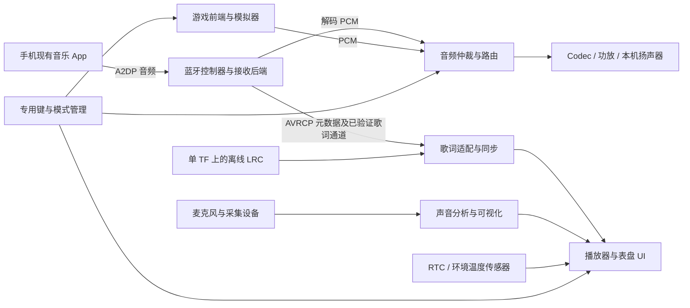

# 游戏掌机 + 蓝牙歌词播放器：二合一产品落地方案

版本：V0.1；日期：2026-10-30。目标按本次要求分两步：**第一步把可稳定使用的游戏掌机做出来；第二步在同一台设备中集成手机蓝牙音乐接收、播放和歌词显示，通过专用键切换使用模式。** 技术风险和验证方法单独见[14 技术瓶颈与验证计划](14_INTEGRATION_BOTTLENECKS_AND_VALIDATION.zh-CN.md)。本文为工程执行方案，尚未安装软件、改机或完成实机验证。

## 1. 本轮实际看了什么，能确认什么

本次打开 JPG，并对四段 MP4 各取 8 个关键时点观察，共 32 帧；视频均为 720×1280，时长由本地现有 OpenCV 读取。**这是关键帧画面复核，没有监听原音轨、蓝牙抓包或验证拍摄设备的真实内部方案**，不能由画面证明声学性能、歌词协议、联网方式或刷新率。

| 素材 | 观察到的内容/时点 | 用于本项目的设计输入 | 尚不能证明 |
| --- | --- | --- | --- |
| [集成-总.jpg](集成-总.jpg) | 桌面播放器与紫色掌机并排；播放器有屏、三大键、摇杆/操纵件、灯光 | 目标是把两种用途合到一个掌机，而非把两机原板简单叠放 | 原播放器应用源码、固件和通信协议可取得 |
| [集成2-0.jpg](集成2-0.jpg) | 屏下 `− / 播放暂停 / +` 大键、操纵件、返回键、上部出音结构 | 音乐模式需要少步骤的实体键交互 | 原播放器声音质量能在小掌机声腔中直接复现 |
| [集成2-1.mp4](集成2-1.mp4)，59.93 秒 | 约 5 秒启动标志；10 秒设备图；20–30 秒角色/黑板主题；45–59 秒其他图像/时钟主题 | 支持多种表盘、动画和按键切换；可参考视觉密度 | 黑板文字是歌曲歌词、设备启动速度或任何无线连接已经成功 |
| [集成2-2.mp4](集成2-2.mp4)，12.04 秒 | 0–11.5 秒时钟、日期、28°图标及持续变化的对称音频可视化 | 时钟 + 声音可视化可组合成一个页面 | 数据一定来自麦克风、一定为 FFT，或 28°是实测环境温度 |
| [集成2-3.mp4](集成2-3.mp4)，60.45 秒 | 约 2–5 秒可视化；10–59 秒多款主题，部分有 `Divoom / Spark your life.` | 表盘应可换，音乐/时钟数据与主题解耦 | 底部文案是真实歌词而不是品牌/演示信息 |
| [集成2-4.mp4](集成2-4.mp4)，60.95 秒 | 猫/狗、山形可视化、雷达风、角色/街景等主题与灯光 | 主题资源、动画和数据控件需独立管理 | 天气、金融等信息可在无 Wi-Fi 情况自动更新 |
| [PC端表盘创作.jpg](PC端表盘创作.jpg) | 屏上给出 Divoom AstroToo PC 编辑器 GitHub 地址 | 可研究其表盘编辑范式 | 编辑器等于掌机端播放器，或已经提供可移植的设备运行时 |
| [rk3326-R36S_V12_2023_08_18.jpg](rk3326-R36S_V12_2023_08_18.jpg)、[rk3326-11.jpg](rk3326-11.jpg)、[rk3326-12.jpg](rk3326-12.jpg)、[rk3326-13.jpg](rk3326-13.jpg) | 板、屏排线、电池/喇叭、GPIO/UART 类位置及芯片区域 | 确定改装空间和测绘对象，建立板/屏/电源接口清单 | 未见线路、I²C 电平、剩余供电能力、RTC 备电与唤醒连通 |

用户前次确认的主板正反面关系继续保留；本轮新增文件名不自动成为新硬件版本。当前媒体文件有重命名/增删，本文件按当前实际文件链接，不重命名用户素材。

## 2. 需求口径：同时参考聊天附图和 V05 草稿

已读[gl二合一游戏机V05.md](gl二合一游戏机V05.md)。它是本地需求评审稿：功能愿望作为输入，里面的兼容性、功耗、协议和源码“已验证”等结论仍需独立证据。本轮不修改该用户草稿，需修正的技术假设列在 14 文档。

| 优先级/来源 | 本轮采用的范围 | 实施边界 |
| --- | --- | --- |
| 核心 P0，本次要求 | 第一步掌机、第二步蓝牙收歌/播放/歌词、专用模式键 | 听歌出声与歌词接入分别验收；只显示歌名不算完成歌词需求 |
| 输入约束，聊天/V05 | 调整按键/摇杆、支持成品 2.4G 手柄；无触摸 | 复用掌机实体键；2.4G 接收器独立占用 USB/功耗和射频资源 |
| 边界，V05 | 全机不配 Wi-Fi，不开发手机端专用音箱 App | 使用手机已有音乐 App；设备不能依赖 LAN、NTP、云端歌词或专用手机伴侣 |
| 存储，V05 | 一张 TF 承载系统、模拟器、内容和播放器资源 | 取代此前双卡首版建议；实际分区/持久化/恢复按目标固件冻结 |
| 功能，聊天/V05 | 麦克风环境声可视化、时钟、独立环境温度、多款表盘 | 麦克风不默认用于通话；时间/温度来源须真实，不把壁纸图标当传感器值 |
| 高优先级扩展，V05 | RTC 备时和关机闹钟唤醒；≥8 种表盘、开放格式 | RTC/唤醒验证在前期安排；未通过不能以黑屏待机冒充关机唤醒 |
| 后续迭代，V05 | PC 可视化编辑/转换、单颗 RGB 及音乐律动 | 开放 schema 先定义；转换器与灯效按计划实现，不能靠搬原厂素材交付 |
| 可选 P2，V05 | HFP 免提通话、游戏音频蓝牙发射 | 与手机收歌不是同一需求；通话涉及回声与独立 profile，单独验收 |
| 待定，聊天附图 | HDMI“加不加待确认” | 先不冻结；不认为旧板有现成 HDMI，加入后评估 SoC/PCB/ESD/结构 |
| 后期，V05 | 4.0 英寸换屏 | 先原屏跑通功能，再独立换屏和回归；不是蓝牙歌词成立的前置条件 |

“设备无 Wi-Fi”不意味着手机播放流媒体无需联网：手机仍可使用自己的移动网络获取歌曲/歌词，掌机只接收实际由手机发出的内容。若要求手机也全离线，测试必须使用手机本地内容且确认是否包含可发送的歌词。

## 3. 应如何把“那个播放器应用”放进掌机

**首选在掌机 Linux 中实现同类播放器/表盘功能，复用同一套屏幕、按键、音频和存储；把蓝牙歌词数据通道作为第一阶段并行预研的门槛。** 先在外接开发环境证明接收和歌词，再决定内置蓝牙控制器或音频模块，避免硬件先焊死。

| 路线 | 实际工作 | 适用条件/决定 |
| --- | --- | --- |
| A：Linux 自研集成 | BlueZ + 合适音频后端，自己实现模式管理、表盘、歌词适配、时钟和外设服务 | 优先原型路线；须证明目标手机/App 的歌词能被本方案取得，不承诺现成 BlueZ 已支持所有私有协议 |
| B：专用蓝牙音频模块 + Linux UI | 模块处理蓝牙接收/已支持歌词；通过 UART/SPI 等送元数据，I²S/模拟音频按设计进入音频链 | A 的歌词卡住时并行询样；必须现场展示**行歌词**输出和可取得 SDK/API，支持曲名不够 |
| C：原播放器运行时授权移植 | 向原厂取得可用于目标 CPU/系统的运行时/源码、驱动接口、协议与素材使用范围 | 资料和授权齐全才评估；目前只有视频/PC 编辑器链接，不具备移植输入 |
| D：整块原播放器板塞进掌机 | 两套主系统协调屏、键、音频、电源、存储与通信 | 不作为默认量产路线；体积、成本、接口争用与维护复杂，不能简单并接 DSI 或扬声器输出 |

[Divoom 官方编辑器](https://github.com/DivoomDevelop/divoom-watchface-visual-editor_AstroToo)明确面向 AstroToo 特定资源，其[README](https://raw.githubusercontent.com/DivoomDevelop/divoom-watchface-visual-editor_AstroToo/main/README.md)介绍的是 PC 端编辑、预览与设备上传流程。它不能替代掌机上的 A2DP 接收、音频驱动、歌词来源或设备端渲染器。研究设计思路与直接复用代码/素材是两回事，复用前另核适用许可。

## 4. 推荐的数据流：声音、歌词、控制分开

本图为路线 A 的逻辑架构，不是当前已存在的服务或原理图。独立源码见[二合一架构图](../diagrams/handheld-bt-integration.mmd)。

**A2DP**用于音频；**AVRCP**用于遥控和媒体信息；歌词需要实际验证的额外语义/通道，不能从音频流自动得到。[Bluetooth SIG AVRCP 规范](https://files.bluetooth.com/wp-content/uploads/dlm_uploads/2024/10/AVRCP_v1.6.3.pdf)与[BlueZ Media API](https://bluez.readthedocs.io/en/latest/media-api/)提供标准功能依据；BlueZ 的 Track/Position 不是通用歌词接口。

## 5. 两步研发与放行条件

### 第一步：先完成可用的游戏掌机

| 工作包 | 需要做的事 | 完成证据 |
| --- | --- | --- |
| G1-01 平台 | 原 RK3326 作研究样机；量产候选按[11 替代方案](11_RK3326_REPLACEMENT_STRATEGY.zh-CN.md)评估，同时审查 BR/EDR、音频采集、USB 与 RTC/唤醒支持 | 精确板/屏/DDR/PMIC/系统、来源与维护资料，不把新平台当旧 DTB 替换件 |
| G1-02 单卡系统 | 一张 TF 的启动/rootfs/用户数据边界、正常关机与恢复 | 整卡备份、配套启动文件/模块/库、可用恢复报告 |
| G1-03 游戏链 | 固定平台、合法测试内容、全部键轴、音量/耳机/扬声器、保存/退出 | [06 原有验收](06_PRODUCT_BASELINE_AND_ACCEPTANCE.zh-CN.md)按新单卡配置重跑 |
| G1-04 硬件预留 | 专用键、蓝牙/天线、Hub、麦克风、RTC/温度、可选 RGB 的空间与电源接口 | 接口控制表、包络/功耗预算和预留，不必先全部内置焊接 |
| G1-05 前置风险小实验 | 在不改变原卡的环境证明目标音乐 App 有可获得的歌词，查电源键/唤醒线路 | 原始日志/样例数据与电气依据；这是减少第二步返工，不取代掌机验收 |

G1 放行：游戏、声音、键轴、保存、正常关机及备用卡恢复可重复；扩展接口来源明确。歌词未验证可以继续掌机工程，但不能把“二合一完整功能”排成已无风险的固定交期。

### 第二步：完成蓝牙歌词播放器并合体

| 工作包 | 交付内容 | 放行条件 |
| --- | --- | --- |
| G2-01 接收声音 | 手机 → A2DP Sink → 本机扬声器；配对/重连、音量与耳机切换 | 手机矩阵中明确哪些组合可用，连续播放、断连和重连无挂起 |
| G2-02 歌词链 | 从被验证的手机/App 通道取歌词，区分行推送、元数据复用与完整时间轴 | 真正歌词可显示，暂停/切歌/拖动不残留；只显示曲名不通过 |
| G2-03 专用切换 | 模式状态机、前端/播放器显示所有权、输入与音频路由 | 按键切换可回退，不丢已完成存档、不双重出声、不因误键切模式 |
| G2-04 表盘/频谱 | 至少 8 种独立资源主题、时间/环境温度、麦克风可视化、歌词页 | 未连接/无歌词/传感器失败有真实状态，未知数据不伪装为有效值 |
| G2-05 时钟/闹钟 | RTC 保时、手动对时、至少 3 组软件闹钟及关机唤醒链 | 唤醒优先验证，需预留开机时间；不把待机响铃记作关机唤醒通过 |
| G2-06 内容创作 | 自有 schema/规范、离线包导入与预览、PC 工具/转换计划 | 无 Wi-Fi 可用；原厂表盘资源/协议不默认可兼容或可分发 |
| G2-07 合体回归 | 游戏/收歌/音频采集/2.4G/充电/热/续航/恢复、地区资料更新 | 同一固件和硬件 ID 下通过完整矩阵，输出发布包与已知限制 |

## 6. 硬件最小方案与接口数

| 模块 | 原型建议 | 必须验证 |
| --- | --- | --- |
| 蓝牙 | 先外接 USB Classic BR/EDR 控制器验证；量产再考虑板载 USB/UART 控制器或路线 B 音频模块 | VID/PID、驱动/固件、目标 BSP、A2DP Sink/AVRCP；BLE-only 不等于可接经典蓝牙音频 |
| USB Hub | 若全部按 V05 的 USB 外设实现，至少需要容纳 4 个下游设备 | 蓝牙、2.4G 接收器、HID/CDC MCU、USB 声卡共四项；留给 U 盘等还需另算端口/电源 |
| 专用模式键 | 可用 GPIO，或独立 MCU 的 HID/CDC；与 RGB/RTC 协调由接口条件决定 | 去抖、长按、唯一设备标识、关机供电、USB 断开时行为 |
| 2.4G 手柄 | 成品接收器/手柄作为冻结配套，不泛指所有 USB HID | 用户态映射、双人玩家顺序、热插拔、与蓝牙同频共存 |
| 麦克风 | 先 USB 采集设备，或验证 codec 的真实可用输入 | 电平/偏置、全双工采放、噪声/反馈、开孔与 RF/充电耦合 |
| RTC | V05 的 DS3231 备时方案进入样件验证；也核查原板 PMIC/RTC 是否有可用备电与唤醒能力 | I²C 访问路径、地址/电平、备电、INT、常供电域与电源键；不能默认随便焊到总线 |
| 温度 | 独立传感器，按精确型号与目标环境选型，远离 SoC/充电热源 | 整机测温误差，而不只是芯片标称精度 |
| 输出 | 首轮复用已验证 codec/扬声器；若音质目标提高，再设计功放、喇叭、腔体与电源 | 原掌机小喇叭不能承诺达到桌面播放器的响度/低频效果 |
| RGB | 单灯 + 驱动/亮度限制，按实际料号测电流 | 电源、逻辑电平、关机漏电/噪声；不写“功耗可忽略” |

若使用 UART 蓝牙、GPIO 模式键或 codec 麦克风，可以减少 USB 端口，但要付出可达线路、驱动和调试成本。Hub 空闲电流、浪涌与背供电同样纳入预算；增加电源不等于直接把充电口 VBUS 并到 Hub。

## 7. 软件模块、输入输出和交付

下面名称是待实现模块，不表示仓库已含源码。

| 模块 | 输入 → 输出 | 实施要点 |
| --- | --- | --- |
| mode-manager | 专用键/故障/闹钟事件 → 显示、输入、音频所有者与状态 | 超时、回退、幂等、多次按键去重、进程崩溃恢复 |
| bt-audio | 配对/连接和手机音频 → PCM/状态 | BlueZ + 一种音频后端；固定版本和 profile，分开接收/发射角色 |
| media-adapter | AVRCP/已验证模块接口 → 曲目、播放状态、位置、歌词事件 | 记录来源和能力，不把所有 Title 更新都当歌词或都当切歌 |
| lyrics-engine | 行事件或离线 LRC + 媒体时间 → 当前行/上下文 | 行推送不一定含完整 LRC，按实际数据类型处理；无时间轴不伪造同步 |
| clock-ui | 模型数据/主题包/实体键 → 表盘、歌词、配对和设置页面 | SDL2 或 LVGL 等按 GPU/BSP 和团队评估，不同时选两套作为必需 |
| capture-spectrum | 麦克风 PCM → 峰值/频段/包络等受控数据 | 环境声可视化与音乐 PCM 可视化分别命名；采样失败不播假数据 |
| time-alarm | RTC/手动对时/闹钟列表 → 时间模型、唤醒计划、铃声 | 单一时间所有者，时区、RTC 无效、重启与断电检查 |
| sensor/rgb | 温度/电池/模式/频谱 → 数据/灯效 | 传感器失联、过热、低电时明确处理 |
| package-import | 离线表盘包 → 校验、资源落盘和索引 | 大小/路径/资源上限、原子应用、出错回退，不运行包内任意代码 |

对直接 ALSA 的旧系统可先评估 [BlueALSA](https://github.com/arkq/bluez-alsa)；新可维护系统可评估 [PipeWire](https://docs.pipewire.org/page_man_pipewire-props_7.html)及会话管理。两者是替代选择，不能让多个音频服务同时抢占同一声卡/profile。工具命令名、包依赖和 ARM ABI 以固定版本及目标 rootfs 为准，不从 RK3326 是 64 位就推断全部应用包架构。

## 8. 专用键切模式，不建议每次重启整机

首选单 Linux 系统的两个应用模式。正常路径：`GAME → PREPARE_MUSIC → MUSIC → PREPARE_GAME → GAME`，失败回到可诊断的先前模式；关机、闹钟与导入使用独立受控状态。V05 的“≤2 秒”作为候选的**菜单就绪切换时间**，不包含首次蓝牙配对、手机重连、冷启动或用户决定如何保存游戏的时间。

游戏运行中按模式键：先给保存/退出选择或执行已验证的模拟器控制流程；确认落盘后释放音频/显示/按键，再开播放器。不能通用 `kill -9`，不能假定所有核心都支持自动即时存档，也不能单靠冻结进程保证 ALSA/DRM 等资源释放。未验证继续游戏能力时，返回游戏模式进入前端并由用户加载存档，界面应明确说明。

音乐转游戏：停止/暂停手机播放按已验证遥控能力处理，静音并关闭本机接收路由、清理按键按下状态，再开游戏声音。手机来电是否触发 HFP 只在可选通话功能验收后开启；默认不抢接电话。

## 9. 歌词产品承诺应怎样写

**本次要求保留“蓝牙接收手机音乐并显示歌词”作为第二步完成条件；V05 期望不加手机 App 的推送路线必须先验证。** 暂时不能承诺 Android/iOS、所有音乐 App、所有曲目都支持，也不能把本地 LRC 兜底当成已实现任意手机推送。

| 情况 | 显示策略 | 验收口径 |
| --- | --- | --- |
| 手机实际发送逐行歌词 | 当前歌词及时间/曲目信息，按真实更新事件滚动 | 登记手机、OS、App/版本、开关、播放场景和可复现日志 |
| 手机发送完整带时间轴文本 | 解析时间戳并跟随播放时间，处理暂停/拖动/切歌 | 实际收到文件/数据格式、长度、编码和时基；不默认标准 AVRCP 会提供 |
| 仅曲名/歌手/位置可得 | 显示媒体信息；若用户已有对应 LRC 可离线匹配 | 匹配不到明确“暂无歌词”；本地匹配属于受限能力 |
| 什么元数据都没有 | 保持声音、显示连接状态和时钟 | 不从声音自动识歌/生成歌词；不冒充完整歌词功能通过 |

国内音乐 App 和海外常用 App 分别建立矩阵，海外不能依赖某个国内“车载歌词”开关就称通用支持。若推送路线不成立：评估路线 B 的有证据模块，或提请调整已承诺的歌词覆盖范围；在需求未调整前该项保持未完成。

## 10. 离线表盘、时钟和声音可视化

采用自有、版本化的 JSON/资源包，建议字段包括：逻辑画布、图层、时间/温度/歌词/媒体/频谱控件、字体/图片引用、动画参数、资源与内存上限。不要把第三方 `disp` 数值一字不差作为自己的兼容承诺；转换器按确切导出样本和许可单独开发。

480×480 资源放到 640×480 屏时，明确选择等比留边、布局重排或有范围的缩放，不把方形表盘直接拉伸当适配完成。首轮原屏实现无触摸的列表/预览/应用，再独立做 4.0 英寸换屏；公开编辑器支持的原厂设备上传/LAN 功能不等于本产品的离线导入接口。

**单 TF 导入优先方案**：关机取卡用 PC 读卡器导入，或设备保持 USB Host 时用 U 盘导入受控目录。若必须“用线连 PC 当 U 盘”，需另设计 OTG 角色切换与专用导入分区/镜像，先安全卸载再导出；系统 rootfs 和正在使用的数据分区不能同时交给 PC 读写，Hub 下游设备也可能随角色切换断开。

时钟使用有效 RTC + 手动对时；无网络天气/股价不加入自动实时功能，环境温度来自独立传感器。FFT 只是可视化一种实现，波形/包络也可满足经确认的视觉目标；需要真实频段时必须采样、标频和测量。关机闹钟按实际冷启动时间设计提前唤醒或常电蜂鸣路径，不把屏灭视作电源已关闭。

## 11. 进度、人员与近期动作

| 阶段 | 责任与可审查输出 | 建议时间口径 |
| --- | --- | --- |
| 需求/取证 | 产品+BSP：固定无 Wi-Fi/单卡/手机矩阵/音质、资料缺口；硬件：USB/电源键/RTC/空间 | 首周；板卡/SDK/样件等待另计 |
| 第一步掌机 | BSP+应用+测试：受控系统、合法内容、输入/音频/存档/恢复及全部 P0；结构完成预留 | 按现有基线是否可用评估，不承诺未到样的新板立刻完成 |
| 蓝牙/歌词预研 | 蓝牙工程：音频/元数据/歌词原始证据，路线 A/B 比较；硬件：唤醒方案实测 | 与第一步并行，设置一轮 5–10 工作日评估窗口，失败如实保留风险 |
| 第二步工程样机 | 应用+蓝牙+BSP：模式/表盘/歌词/频谱/RTC；硬件与结构完成合体 | 关键通道已通过后再做排期，预留联调和回归，不能沿用旧“纯掌机”日期 |
| 量产前 | 测试+制造+发布：功耗、RF/2.4G、充电、温度、售后/地区合规、镜像与版本 | 按目标市场重新评估；无 Wi-Fi 仍是有蓝牙发射的产品 |

立即可执行：①保存原卡并形成 G1 用例；②列目标手机/OS/App/版本与歌词场景；③外接验证 A2DP/元数据/歌词，不先做内置改焊；④按四 USB 设备重算端口、电源和空间；⑤查 RTC/电源键与冷启动时间；⑥给专用音频模块供方索取逐行歌词 SDK/API 演示；⑦上述证据齐备后冻结播放器路线和二合一交期。

本轮交付是媒体关键帧复核、协议/开源项目资料核查与研发方案，不是已经移植了播放器。没有运行原厂编辑器或下载/安装新工具，未改动 DTS、DTB、boot.ini、内核及连接设备。
