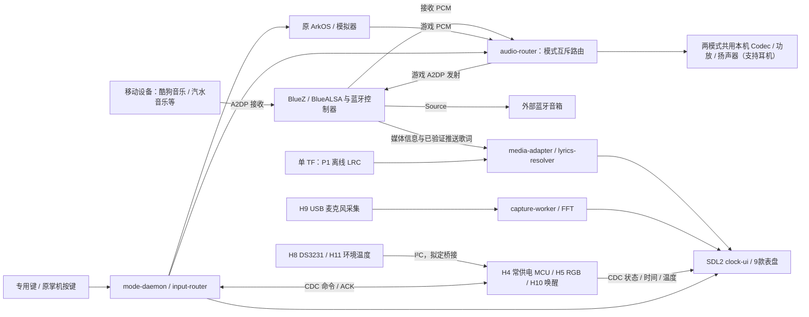

# 按 V05 实施 R36S 二合一掌机：详细设计与研发交付书

版本：V0.2；日期：2026-10-31；需求基线：[gl二合一游戏机V05.md](gl二合一游戏机V05.md)，v0.5（2026-10-29）。本文件回答“谁做、接哪里、写哪些模块、怎样串起来、交付什么”；[14 验证与攻关手册](14_INTEGRATION_BOTTLENECKS_AND_VALIDATION.zh-CN.md)规定验证步骤、记录和放行标准。

**本轮对象明确为 R36S / RK3326 / 现有 ArkOS 的改装，不把切换 SoC或换成 Android 作为实施前提。** [11 平台替换调查](11_RK3326_REPLACEMENT_STRATEGY.zh-CN.md)仅用于后续量产供货决策。先建立可恢复的掌机基线，再把播放器合入；外设、歌词和电源键预研可以并行。本文全部目录、服务、协议和代码片段均为待实施设计，不代表仓库已有这些软件或实机验证结果。原 V05 文件保持不变。

## 1. 产品核心与 V05 功能合同

**二合一的核心：把蓝牙音箱功能合并到掌机中，通过同一个专用物理键，在游戏模式和蓝牙音箱模式之间切换。两种模式共用本机扬声器、功放及音量控制。** 按最新需求明确以下行为，原 V05 的其余功能继续保留：

| 用户场景 | 声音来源与播放路径 | 掌机行为 |
| --- | --- | --- |
| 玩游戏 | 本机模拟器 → 本机音频输出 → 功放 → 本机扬声器 | 本机扬声器默认播放游戏声音；手机音乐不得自动抢占 |
| 切为蓝牙音箱模式 | 手机等移动设备上的酷狗音乐、汽水音乐等 App → 移动设备蓝牙输出 → 掌机蓝牙接收 → 本机音频输出 → 同一功放和扬声器 | 移动设备负责选歌和播放，掌机作为蓝牙音箱接收并发声；歌词按 FR-7 的兼容性验证结果显示 |
| 切回游戏模式 | 停止本机播放手机音频，恢复游戏音频路径 | 保护游戏存档与运行状态；手机仍连接时也不能混入游戏声音 |

这条核心链路不要求把音乐 App 安装到掌机中。酷狗音乐、汽水音乐列为首批必测 App，分别验证音乐接收、播放控制和歌词，不能用“能播放声音”推定“能接收歌词”。V05 的游戏声音发往外部蓝牙音箱功能继续保留为另一条输出路径，不作为上述本机音箱功能的前置条件。

P0 是核心交付，P1 是正式排期的增强交付，P2 才允许按 V05 裁剪。V05 未单独标级但明确要求的功能，下表纳入基本交付；不能因尚未测通就自行改成可选。阶段样机缺项时必须标出，不能写成完整版。

| 需求 | 本版落实内容 | 对应实现与验证 |
| --- | --- | --- |
| FR-1 | 新增物理键；默认长按 1 秒确认模式切换；切换目标≤2秒；异常回退 | mode-daemon、输入仲裁、资源交接；T01/T02 |
| FR-2 | 保留原 ArkOS 玩法、键位和存档；默认本机扬声器播放游戏声音；保留本地 / 外部蓝牙音箱 / 静音三路；外部音箱断连回本地 | audio-router、A2DP Source、玩家编号；T03/T04 |
| FR-3 | 蓝牙音箱模式接收手机等移动设备的 A2DP 音频，共用游戏模式的本机功放/扬声器；酷狗音乐、汽水音乐首批必测；AVRCP 播放暂停 | bt-adapter、BlueZ/BlueALSA；T05/T06 |
| FR-4 | A/B/R2/L2/左摇杆/SELECT+START/专用键按 V05 复用，纯按键无触摸 | input-router、上下文优先级；T02 |
| FR-5 | 单颗 WS2812B、亮度/呼吸/渐变、模式配色为基本交付；麦克风同源律动为 P1 | MCU/RGB 控制及频谱数据；T07 |
| FR-6 | ≥8 款表盘；工程计划制作列出的9款，全部带时间、环境温度、电量和连接状态；含动画和麦克风 FFT | clock-ui、渲染器、capture-worker、sensor；T08/T09/T10 |
| FR-7 | P0 使用手机已有音乐 App，通过蓝牙向掌机发送音乐和歌词，**不需要 Wi-Fi**，掌机不联网搜索或下载歌词，也不开发手机专用 App；手机 App 自身是否联网不受此限制。P1 支持本地 LRC；收不到歌词时继续播放音乐，显示能取得的歌名/歌手/进度或“暂无歌词”，此兜底不算完成 P0 歌词功能 | lyrics-resolver 与手机兼容矩阵；T11/T12 |
| FR-8 | 运行、待机、软件关机三种状态均支持已启用闹钟；≥3组每日/工作日/单次，5秒渐强，A停止、B贪睡5分钟；待机唤醒和关机开机响铃均为必做 | alarm-engine、H8/H10、MCU、系统唤醒适配；T13/T14 |
| FR-9 | 必配 DS3231，RTC优先、手动对时兜底；无效时间有提示，不误响铃 | time-sync、MCU RTC桥、time_valid；T13 |
| FR-10 | P0开放schema/开发规范/手写包导入与管理；P1 PC可视化编辑器和AstroToo JSON转换器 | package-manager、PC工具、兼容表；T15/T16/T17 |
| H3 | 增加成品2.4G手柄，支持双人 | USB接收器、输入映射、热插拔；T04 |
| H6 | 最后实施4.0寸屏，先选640×480；480×480为经评审的候选 | 屏规格、DTS、结构与UI回归；T18 |
| H9 / P2 | 麦克风首先承担环境拾音频谱；HFP免提通话仅为P2 | 默认不注册通话角色；启用后另做T19 |

游戏蓝牙外放、4寸屏、DS3231和USB连PC导入都保留为明确工作项，不再归为“以后可考虑”。本地LRC不是P0手机推送的替代验收；换读卡器也不是FR-10 USB线连PC的最终替代。P1编辑器/转换器要有正式任务、预算与交付版本。

## 2. 固定边界与发布阶段

- 一张TF卡容纳系统、模拟器、游戏、存档、播放器程序/表盘/歌词/铃声；不回到双卡方案。
- 无触摸；全部设备侧操作通过物理按键/摇杆完成；不开发手机专用App。
- 原游戏功能通过同一基线用例回归；“原样运行”指用户功能和数据保留，不是承诺绝不修改任何必要的音频/启动配置。每项配置变更可追溯、可回退。
- 原3.5寸屏用于阶段0–5联调；4.0寸换屏在阶段6完成。原屏阶段的成功不能宣称满足4寸最终目标。
- RTC/电源键电路测绘在阶段0；H10集成在阶段5。关机唤醒不能拖到量产前才首次验证。
- 本轮不引入HDMI、新网络服务或双系统启动；HFP按P2单独构建/验收。

阶段版本：D0=可恢复掌机；D1=外设/双角色音频；D2=歌词/9表盘/闹钟/schema应用；D3=RGB/关机唤醒；D4=4寸整机；D5=PC编辑器/转换器。D2/D3使用原屏应在版本说明中写清；最终交付清单逐项列出P0、P1和是否启用P2。

## 3. 开始编码前的基线取证

由BSP和测试负责人共同完成，不依靠照片推断1GB RAM、容量、驱动或主板全部线路。

| 工作 | 输出文件/记录 | 通过条件 |
| --- | --- | --- |
| 原卡/备用卡 | 整卡备份、分区表、BOOT文件与SHA-256、恢复记录 | 原卡封存；备用卡复现显示/输入/声音/充电/存档 |
| 运行环境 | 内核/架构/libc/声卡/显示后端/输入节点/系统服务 | 精确系统、BlueZ现状、设备权限及ABI可查 |
| 游戏基线 | 测试平台/核心/合法内容/玩家顺序/保存方式 | 至少覆盖一个独立模拟器和一个libretro核心，逐项记录 |
| USB/电源 | 控制器/UDC、Host/Device能力、OTG口与充电口角色 | U盘导入可行性与外设共存不是仅凭OTG丝印判断 |
| 常电/电源键 | 按键网络、关机后电平/电源域、冷启动时长 | H10接法与脉冲条件有测量依据 |
| 主板/屏 | 板正反面、屏完整料号、接口/供电/时序与空间 | 不把Panel 4 - V22当普通Panel4，不按同族机名照搬DTB |

实际加载依据为目标卡配置。[Panel4.dts](../../DTS/Panel4.dts)与[参考boot.ini](../../R36S/Panel%204/boot.ini)用于理解现状，不整份覆盖目标卡；保留目标root、UUID、地址、Image和initrd配套。缺少工具/文件时记录缺口，不自动安装或盲换内核。

## 4. H1–H11 硬件落地表

| 编号 | 需求器件 | 本版工程实现 | 下单/内置前的验收输入 |
| --- | --- | --- | --- |
| H1 | USB Hub | 原型外接，内置至少覆盖4个USB下游设备；H1从“一拖三候选”修正为满足实际端口数的器件 | Host拓扑、数据完整性、峰值/浪涌、电源开关/反灌、尺寸 |
| H2 | RTL8761B系等USB蓝牙候选 | 先验证指定VID/PID与firmware，BR/EDR A2DP双角色/AVRCP；不按型号广告承诺旧内核兼容 | 同一ArkOS/内核下双方向、重连和歌词通道证据 |
| H3 | 2.4G手柄/接收器 | 冻结成套产品及HID映射，内置接收器 | 双人玩家顺序、热插拔/共频与功耗 |
| H4 | 模式键MCU | 首选有资源余量的USB HID+CDC复合设备，兼管RGB、RTC与温度；CH552T/Pro Micro等仍是待评候选 | USB能力、RAM/Flash、I²C、常电睡眠、唤醒IO和时序实测 |
| H5 | WS2812B×1 | MCU定时驱动，模式/亮度控制；P1消费同一麦克风频谱帧 | 精确灯珠电气、峰值电流、逻辑电平、漏电与透光位置 |
| H6 | 4.0寸屏 | 阶段0收规格，阶段6才替换；640×480 4:3优先，480×480候选须明确比例变化 | 完整MPN、FPC/供电/DSI/初始化、结构、背光和DTS |
| H7 | 线束/支架/隔离辅料 | 从带版本总装与接口表导出，不用“漆包线若干”作为最终BOM | 线序、绝缘、固定、应变释放和可拆修 |
| H8 | DS3231+备份供电 | 按V05必配；建议MCU作为其I²C访问主控，Linux通过CDC取/设时间 | 精确型号、备电、I²C电平/上拉、失效标志、告警与走时 |
| H9 | USB采集声卡+麦克风 | 单独采集通道，默认不回放到本机扬声器；为FFT提供PCM | 采样格式、偏置/供电、采放并行、拾音开孔与噪声 |
| H10 | 关机唤醒电路 | RTC INT→常供电MCU→按已测电路生成受控电源键等效脉冲 | 常电稳压/隔离、睡眠电流、键线电平、触发/清标志、故障保护 |
| H11 | 环境温度传感器 | 与DS3231挂同一MCU侧I²C总线，远离热源；按±0.5°C整机目标选准确MPN | 数据手册、装配位置、标定、热机/充电下误差与刷新 |

H8/H11接MCU是明确的**新增设计建议**，用于避免默认可焊接R36S PMIC总线，并让H10关机后独立工作；不是已验证接法。若选择SoC直连，必须交付可用I²C位置、电压域、常电隔离和唯一访问所有者。RTC/MCU常电不能由“USB总线断电后仍有电”假设替代。

USB下游预算：H2蓝牙、H3接收器、H4复合MCU、H9声卡共4个；复合HID+CDC仍占一个物理端口。导入采用Host/Device切换时不要求它们在PC导入期间在线；增加外接U盘/其他外设才另算扩展口。H1数量修正保留原功能，不默删外设凑三口。

量产前每器件绑定MPN/版次/引脚/额定/来源/批次/测试结果；电池约3500mAh及“内核驱动现成”等V05描述不作采购实测值。电源键、充电、5V与MCU引脚没有具体电路依据前不下发飞线坐标。

## 5. 明确的软件与MCU分工

下图为待实现主线，Source/Sink按模式互斥；MCU桥接/常电方案须先通过硬件评审。独立源码见[架构图](../diagrams/handheld-bt-integration.mmd)，USB导入的角色/卷所有权按第12节单独执行。




### 5.1 进程、数据和所有者

| 模块 | 单一职责 | 接口/持久化 | 负责人角色 |
| --- | --- | --- | --- |
| mode-daemon | 模式状态、输入/显示/音频租约、故障回退、导入协调 | 本地IPC、当前模式/事务号；不代替模拟器保存接口 | BSP/系统 |
| input-router | 识别MCU和原joypad，长按去抖、上下文分发 | evdev→动作；切换时清理按下状态 | 应用 |
| audio-router | 本地/BT/静音路由、profile连接与断连回退、闹钟抢占 | ALSA/BlueALSA适配，路由快照 | 蓝牙/音频 |
| media-adapter | AVRCP媒体状态、控制、已验证歌词协议适配 | 标准化曲目/进度/歌词事件，保留原始来源 | 蓝牙 |
| lyrics-resolver | P0推送优先、P1本地LRC解析/匹配、失效清理 | 当前行/时间轴/来源/状态，不把每行当新歌 | 应用 |
| clock-ui | SDL2全屏、9表盘、歌词、设置/配对/导入/闹钟页 | 只消费模型；不在绘制线程阻塞USB或采音 | 应用/UI |
| capture-worker | USB麦克风采样→FFT/包络与质量状态 | 有界环形缓冲、频段数据/时间戳 | 音频 |
| time-sync / alarm-engine | RTC/手动时间有效性、3组以上闹钟、贪睡和下一次唤醒 | 系统UTC时间、闹钟列表、MCU设置ACK | 系统/MCU |
| mcu-bridge / rgb-ctl | MCU发现、握手、传感器/告警、模式灯效 | CDC协议，版本/序号/超时；复连自动读状态 | MCU |
| package-manager | 导入包、schema/资源校验、原子应用、转换报告 | 只读程序与可写数据分离、上一有效包 | 应用/PC工具 |

SDL2为V05主路线；开发机可先用模拟数据跑UI，但功能验收使用真实蓝牙、麦克风、RTC和传感器。选定固定BlueZ/BlueALSA版本，避免在旧ArkOS上无理由同时再引入PipeWire/PulseAudio抢设备。[BlueALSA上游](https://github.com/arkq/bluez-alsa)现行与历史组件名称不同，服务文件按冻结版本生成，不把文档名称当已安装命令。

### 5.2 本地事件合同

建议使用Unix域套接字，消息有版本、序号、单调时钟时间戳与来源。以下为**拟定接口示例**，待工程评审后实现：

```json
{
  "v": 1,
  "type": "lyrics.line",
  "seq": 17,
  "session_id": "phone-session-1",
  "track_key": "track-2",
  "source": "bt_push",
  "timebase": "arrival",
  "position_ms": null,
  "text": "自有测试歌词",
  "received_mono_ms": 123456
}
```

核心事件：mode.request/ready/failed、audio.route/transport、media.track/state/position、lyrics.line/timeline/clear、spectrum.frame、sensor.temperature、clock.validity、alarm.fire/stop/snooze、import.ready/result。行推送没有时间轴时position_ms为空，不能伪造LRC时间；timebase分arrival和media两类。事件长度、队列上限、断连重订阅与超时错误必须写入接口规范。

### 5.3 MCU合同

MCU负责HID模式键、WS2812、H8/H11 I²C、RTC告警及关机唤醒。CDC命令至少包括：

| 命令/事件 | 必要字段 | 完成条件 |
| --- | --- | --- |
| HELLO / STATUS | 协议/固件版本、板ID、唤醒原因、RTC与传感器状态 | 不兼容协议拒绝危险写操作 |
| RTC_GET / RTC_SET | UTC秒、时间有效标志、请求序号 | 写后读回；Linux只有ACK后才标RTC已同步 |
| ALARM_ARM / ALARM_CANCEL | 目标UTC、响铃UTC、模式策略、事件ID | 有效时间/常电能力检查，ACK与读回一致 |
| SENSOR_REPORT | 温度、状态、采样时间/序号 | 失联不继续把旧值当实时值 |
| LED_SET | 模式、亮度、颜色或低频律动参数 | MCU限额，Linux不传WS2812逐bit时序 |
| WAKE_REASON / ALARM_CLEAR | 事件ID、原因、处理结果 | 一次唤醒一次消费，防重复按电源键 |

建议一份硬件看门狗策略防止告警脚保持低电平而重复开机。主供电关闭后MCU保留闹钟工作，USB VBUS只作感知/连接用途，常电与PC口不得背供电；具体器件/连接须由H10电气设计决定。

## 6. 模式与按键：照V05实现，给出交接事务

| 状态 | 允许的显示/音频 | 进入/退出条件 |
| --- | --- | --- |
| GAME | ES或模拟器；本地/BT外放/静音 | 启动基线或音乐退出成功 |
| TO_MUSIC / TO_GAME | 转换提示；音频先静音 | 资源/保存ACK齐备才提交；失败回原稳定态 |
| MUSIC | 表盘/配对/设置；手机A2DP接收 | Sink准备、输入和显示租约成功 |
| ALARM | 本机铃声与闹钟页，最高基本音频优先级 | 时间/范围有效；A停止/B贪睡后按策略返回 |
| PC_IMPORT | 导入提示；无蓝牙音频/USB手柄依赖 | 受控USB Device模式；完成后重枚举并返回 |
| SHUTDOWN / RECOVERY | 安全关机或故障页 | 闹钟写入ACK、数据落盘；不可重入普通模式事务 |

默认1秒长按只产生一个切换请求，按键抬起后才接受下一次；键码绑定MCU身份，避免2.4G手柄同码误触。≤2秒要求不取消：记录按下、长按确认、资源释放、目标可操作时刻；建议以长按确认到目标可操作计切换耗时，同时报告全动作耗时。若V05的最终验收要从首次按下计2秒，则另按此口径判定，不能只改统计口径让失败变通过。

游戏中切换：提交请求→检查核心/存档适配→必要时提示保存/取消→确认保存落盘→释放PCM和显示→准备Sink→开UI和音乐输入→提交状态。核心无安全退出/恢复能力时保留游戏，不强杀；把该核心支持边界记录为缺陷，不宣称所有游戏无感切换。保存等待不隐藏在2秒指标之外，日志分别报告并交产品评审。

| 输入 | MUSIC正常页 | 设置/管理页 | ALARM页 | 可选HFP来电 |
| --- | --- | --- | --- | --- |
| A | AVRCP播放/暂停 | 确认/应用/进入项目 | 停止并消费本次闹钟 | 接听 |
| B | 无操作 | 返回/取消，不作系统返回键滥用 | 贪睡5分钟 | 挂断 |
| R2 / L2 | 音量+ / − | 与页面定义一致，避免改设置值 | 铃声音量策略受控 | 通话音量 |
| 左摇杆 | 左右切表盘，一次越阈值一次切换 | 选项目/调数值 | 不切表盘 | 按来电页白名单 |
| SELECT+START | 进入时间/闹钟/管理设置 | 退出设置 | 不误清闹钟 | 不触发游戏热键 |
| 专用键长按 | 请求回游戏 | 有未保存操作先确认 | 先处理闹钟再切换 | 不因切模式自动接听 |
| 其他 | 忽略，不透传游戏 | 仅页面明确启用的操作 | 忽略 | 仅明确操作 |

页面层级≤2：表盘→设置索引→时间/闹钟/蓝牙/表盘管理/亮度/诊断等功能页，以页内焦点完成编辑，不继续叠加多级菜单。P2关闭时不注册HFP，不出现接听/挂断入口。

## 7. FR-2 / FR-3 双向蓝牙音频实现

实施顺序先打通“游戏本机发声 → 物理键切换 → 手机音乐本机发声 → 切回游戏”的完整闭环，再联调 V05 要求的游戏蓝牙外放路径。系统统一管理本机播放通道，模式切换先渐弱/静音旧声音、停止旧音频写入并释放占用，再接入新声音并渐强；不能让两套应用各自争抢声卡。沿用现有音频硬件是否满足音量、失真、底噪与温升目标，须经整机测试后决定，不能仅因新增音箱模式就认定必须增加第二套扬声器或功放。

1. 固定控制器、固件、内核、BlueZ、BlueALSA与SBC基线，列清ARM用户态ABI/动态库；先外接验证再内置。
2. Source路径：模拟器→可控ALSA PCM→BlueALSA编码→外部蓝牙音箱。审查每个模拟器是否绕过默认PCM直接打开hw设备；必要配置做独立补丁和回退。
3. Sink路径：手机→A2DP→BlueALSA接收PCM→受控播放通道→现有codec/喇叭。设置本机音量、耳机切换、重连和停止策略。
4. 游戏模式提供本地/蓝牙/关闭三选一，保存选择；蓝牙断开时按V05回本地，用限幅/渐变避免回退时突然大音量，并显示提示。
5. 音箱模式A键控制手机AVRCP，不只暂停本机PCM；手机不支持时明示控制不可用。
6. Source与Sink按模式互斥使用；“双角色”不等于必须同时把手机音乐转发给第二只蓝牙音箱。闹钟始终有本机出声路径。
7. 保存蓝牙已配对设备有用户删除入口；配对仅在用户可见窗口开放。蓝牙功能纳入无线和安全交付。

[BlueZ媒体API](https://bluez.readthedocs.io/en/latest/media-api/)中的Track/Position为元数据能力依据，不是歌词服务。只会枚举hci0或手机配对成功，不算完成上述音频与控制链。

## 8. FR-7 歌词：保持P0推送主线，建立可替换适配层

目标Android手机的既有音乐App及“车载歌词”开关是第一组P0组合；iOS和其他App列实测矩阵，不用V05中的平台推断代替结果。私有AVRCP扩展是首选待验证实现，不把“看到Vendor Dependent封装”当已证明私有歌词；也检查Title复用等实际数据路径。[AVRCP规范](https://files.bluetooth.com/wp-content/uploads/dlm_uploads/2024/10/AVRCP_v1.6.3.pdf)

| 数据情况 | 实现 | 验收边界 |
| --- | --- | --- |
| 逐行推送 | 保存行事件与会话/曲目身份，收到后更新歌词，失联清理 | 无完整时间轴不虚构LRC；暂停/切歌/拖动后不得残留 |
| 完整带时标数据 | 解析为内部时间轴，以远端播放位置和单调时钟同步 | 区分远端时基、本机音频缓冲和UI延迟 |
| P1本地LRC | 从用户数据lyrics目录读合法来源文件，按曲名/歌手/时长等匹配；允许确认版本 | 不能保证任意流媒体/Live版都匹配 |
| 无歌词 | 转媒体信息形态，保留时间/温度与连接状态 | 属V05失败降级，不算P0歌词验收通过 |

至少交付两个适配接口：metadata/control和lyrics，不把歌词协议写死进表盘。每行Title更新若表示歌词，不重置曲目/本地匹配；用户换曲或远端会话变更后才清会话。歌词为不可信文本，限定长度/编码并禁止当命令执行。

若Linux栈缺接口：先用抓包确认PDU/属性与发送端行为，再选栈补丁或有完整SDK的音频模块。模块必须展示同一手机的**逐行文本输出**及时间/状态，不接受只有歌名的“歌词支持”。替换控制器/后端不得删掉FR-2发射功能或改变手机无新App约束。

## 9. FR-6 频谱、9款表盘与环境温度

| 主题ID | 工程交付内容 | 数据要求 |
| --- | --- | --- |
| WF01 | 极简数字钟 | 时间/连接/电量/环境温度 |
| WF02 | 模拟指针 | 时分秒指针及统一状态栏 |
| WF03 | 复古像素+帧动画 | 独立可授权图片/字库与时间 |
| WF04 | 翻页钟 | 时间更新事件驱动动画 |
| WF05 | 歌词大字报 | P0推送/P1本地LRC及来源/无词状态 |
| WF06 | 仪表盘风 | 时间+播放状态/歌词或进度控件 |
| WF07 | 霓虹渐变 | 与单颗RGB主题一致，律动为P1 |
| WF08 | 媒体信息 | 曲名/歌手/专辑/播放位置；缺属性明确为空 |
| WF09 | 音频频谱 | H9麦克风真实采样+FFT，时间与状态栏保留 |

做9款覆盖V05所列风格，而非用8张静态壁纸凑数。所有表盘须显示时间和H11环境温度；未连接显示等待连接。传感器/RTC无效有专门标记，SoC温度仅在诊断及真实超温安全处理使用，不伪装环境值。温度目标±0.5°C、分辨率0.1°C保留；建议以1秒采样同时满足草稿周期要求，最终测法见14。

采集建议以声卡支持的48kHz/单声道起步，1024点Hann窗FFT，重叠采样；输出对数频段/能量、噪声门限和稳定状态，20fps以上刷新、端到端≤100ms是验收目标。所有数值为待验证工程参数，不保证任意声卡达标。PCM线程与UI解耦，绘图拥塞时丢旧可视化帧，不阻塞音频。默认不把麦克风回放到喇叭；采集故障停止动画并提示。

自家喇叭声音会被麦克风拾取，这是“环境声音频谱”的真实混合声场；不得用播放器PCM静默替代H9采集。可另提供音乐PCM可视化，但不代替WF09。RGB律动消费同一份FFT/能量数据，避免另建不同步的采样链。

## 10. FR-8 / FR-9 时间与运行、待机、关机三态闹钟

按最新需求，已启用且时间有效的闹钟在运行、待机和软件关机状态都必须生效，覆盖游戏与蓝牙音箱两种模式。此项更新原 V05 的模式范围：默认全局生效，不再以关机前处于音乐模式作为响铃条件；原 V05 文件保留作为历史基线。

| 电源状态 | 到点行为 | 必须完成的实现与证据 |
| --- | --- | --- |
| 正常运行（游戏或音箱模式） | 抢占本机音频，显示闹钟并响铃 | 保留原音频路由和游戏状态；停止后恢复原模式，手机播放恢复策略明确 |
| 待机 | 唤醒屏幕和必要系统资源后响铃 | 分别验证仅灭屏、系统挂起；记录实际进入的状态，不能以灭屏测试代替挂起唤醒 |
| 软件关机，主电池连接且电量足够 | 提前唤醒开机，到设定时刻响铃 | RTC/常电/电源控制及启动直入闹钟链路通过实测 |
| 拔电池、运输硬断电或电量不足以启动 | 不承诺响铃 | RTC备电仅用于保时；恢复供电后提示错过的闹钟，避免重复触发 |

进入系统挂起前保存最近事件、完成RTC设定和读回，并确认目标内核与硬件的有效唤醒路径。MCU/RTC需根据主机电源状态选择“通知运行中主机”“触发挂起唤醒”或“触发关机开机”；不能向运行中的主机盲发电源键脉冲，避免误关机。USB CDC在挂起后能否唤醒不可预设，必要时设计经测绘确认的专用唤醒信号。恢复后校时、恢复声卡并消费同一事件ID，避免软件定时器和RTC各响一次。

### 10.1 时间有效性

DS3231是主时间源，主机启动先向MCU读取RTC与失效状态，再设置系统UTC；界面根据明确时区显示。RTC失效→time_valid=false→提示未同步并跳过闹钟；用户手动对时后恢复本次运行的有效时间，同时尝试写RTC并读回。写RTC失败时区分“仅本次有效”和“可断电保时”，不能承诺故障RTC重启后仍可靠。

原厂DS3231的走时精度有温区/型号条件，两个硬件闹钟也不等于能直接容纳3组用户规则；按[器件数据手册](https://www.analog.com/media/en/technical-documentation/data-sheets/ds3231.pdf)实现寄存器与告警处理。MCU为I²C主控时采用桥接，不同时让Linux另加载直连驱动争用。

### 10.2 规则与响铃

每条记录至少有id、enabled、kind（daily/workday/once）、当地时间、时区、铃声、响铃音量、scope（固定为global）、贪睡信息。历史speaker_only记录迁移为global并提示用户，不能继续限制游戏模式或关机后的提醒。workday基础定义为周一至周五，不在无网络设备上承诺自动识别法定调休；若需要调休可离线日历导入另评审。

调度器计算下一次UTC事件，最近事件写RTC；先保存完整列表再ARM，必须收到ACK后才能宣称待机/关机提醒已准备。铃声从单卡受控目录读取，5秒渐强至设定音量；A停止、B延后5分钟。所有已启用且时间有效的闹钟全局生效，不依赖关机前模式。待机或关机前设定失败必须显示提醒能力异常，不能静默丢失事件；贪睡、取消、改时及响铃结束后均重新计算并设定下一次事件。

### 10.3 关机到响铃

保存规则/最近事件→ARM并读回→安全关机→MCU/RTC留常电→INT告警→一次受控键脉冲→开机读唤醒原因→在合法音频初始化后直入闹钟页→响铃→清事件与重排。电池已拔/运输硬断电不承诺唤醒。

需分别测最坏挂起恢复时间和冷启动时间。要求T点响时可使用T减对应裕量预唤醒、主机等待T再响；MCU保存响铃T和预唤醒时间，不能提前响铃。过晚恢复/开机有明确missed策略/日志。RTC走时、待机唤醒、软关机唤醒和响铃准点性分别验证，三态任一通过均不能替代另外两态。

## 11. FR-10 开放格式与PC工具：明确P0、P1两套交付

### 11.1 P0格式与运行时

交付schema v0.1、开发规范、disp目录、字体清单、9套自有表盘包、示例、校验结果和离线导入说明。对齐AstroToo声明式ItemList/字体ID/disp设计，保留已确认低位语义，歌词/连接/温度/频谱等自定义控件使用1000+段；未核对的原厂控件不能编造兼容。

本轮核对了原厂[作者指南](https://raw.githubusercontent.com/DivoomDevelop/divoom-watchface-visual-editor_AstroToo/main/docs/AI_WATCHFACE_GUIDE.md)、[schema](https://raw.githubusercontent.com/DivoomDevelop/divoom-watchface-visual-editor_AstroToo/main/docs/watchface-config.schema.json)和[disp目录](https://raw.githubusercontent.com/DivoomDevelop/divoom-watchface-visual-editor_AstroToo/main/docs/generated/disp-catalog.json)。它们可作字段对照，不等于已获资源使用授权；本地V05提到的调研笔记目前未在仓库找到，不能据此声称本产品运行时已经完成。

下面是**本项目拟定格式**，不是可直接刷进原厂设备的已验证文件；font=101代表待建立的自有字体目录，低位disp=5按公开目录的时分秒语义映射，1004为拟定环境温度控件：

```json
{
  "schema_version": "0.1",
  "package_id": "gl.example.clock",
  "NameCn": "基础时钟",
  "canvas": {"w": 480, "h": 480, "fit": "contain"},
  "ItemIdList": ["clock", "temperature"],
  "ItemList": [
    {"item_id": "clock", "disp": 5, "font": 101,
     "x": 40, "y": 90, "w": 400, "h": 100, "size": 56},
    {"item_id": "temperature", "disp": 1004, "font": 101,
     "x": 280, "y": 400, "w": 160, "h": 40, "size": 24}
  ]
}
```

包内包含manifest、表盘JSON、fonts/images/frames等自有资源及哈希/来源清单。控件定义包括布局、层级、透明度、时区/绑定字段、动画时长、无数据样式。已知导入包出现未知disp时按schema拒绝并给出位置；运行时为向前兼容可跳过未知图层，但始终保留内置时间/温度状态层，避免空屏。恶意路径、超大/压缩炸弹、缺资源、字体/帧数过限均拒绝。

### 11.2 P1 PC编辑器与转换器

编辑器需完成离线打开/保存、画布拖动/对齐、控件/资源/动画属性、实时模拟预览、校验与导出；预览在PC本机完成。提供Windows基础交付，其他OS按团队资源排期，不把手机App作为导入依赖。

转换器输入明确版本AstroToo JSON及有使用权的资源，输出本产品包、控件映射、字体重映射、坐标适配和不支持报告。480×480可等比保留；640×480默认居中留边或按可重排控件布局，禁止无提示拉伸。时钟与图层、GIF/帧动画分别建立固定样例；缺字体/原厂专有图层不能“转换成功但空白”。

## 12. 单TF与USB连PC的完整导入路径

### 12.1 数据目录与更新

建议另行实施：只读版本化程序放/opt/gl2in1/releases，current指向当前发布；配置/表盘/lyrics/ringtones/logs放单卡可写数据区的gl2in1目录，真实挂载点由基线确认。示例目录不是当前仓库文件，也不强行把所有ArkOS路径改成该名字。

先核实真实开机钩子/服务和执行时机，再将mode-daemon接入；custom.sh是否存在及OTA如何处理均以目标卡为准。更新必须包括依赖/ABI、默认配置迁移、回退版本及数据保留测试，不把“放独立目录”当永不被OTA影响。

### 12.2 FR-10最终用户流程不删减

`进入导入页 → 接USB线到PC → PC出现导入盘 → 拷入表盘包 → 安全弹出 → 设备校验/刷新 → 返回音乐或游戏`。

推荐工程路径：SoC同一OTG控制器经USB2.0数据路径选择连接“内部Hub”或“外部PC口”；Host模式用Hub，Device模式导出专用导入卷。必须先查目标UDC/驱动、CC/ID与VBUS电源角色，再确定数据开关/器件和接法，不能用Hub当Host/Device转换器。

导入卷可先用同卡上的预分配FAT镜像文件实现，避免为原型直接改系统分区；它在PC端仍表现为独立U盘。不导出rootfs、游戏/存档正在使用的分区或整张TF。[Linux Mass Storage Gadget](https://docs.kernel.org/usb/mass-storage.html)支持文件/块设备作后端，但导出期间本机不得挂载/修改同一后端卷。

进入PC_IMPORT：保存并释放游戏/音乐→关闭蓝牙流和USB采集→卸载导入卷→Host断开并隔离不允许的VBUS路径→连接Device路径并绑定gadget。安全弹出后：解绑/断开gadget→校验卷→本机只读扫描/校验包→复制到staging→原子登记→卸载卷→恢复Host和外设握手→返回原模式。突然拔线不立即信任半包，保留上一有效表盘与存档。

PC导入期间MCU USB可能离线，但H10常电独立，原掌机GPIO按键/屏仍用于退出提示。闹钟触发时不得强拆仍被PC写入的卷；先保留导入事务并用主机已有本地音频路径响铃，提示用户处理，退出后再正常重连。卡槽读卡器/U盘只作为调试备用，不能替代本段最终验收。目标硬件不具备必要Device/UDC能力时，此项保持未完成，进入硬件/内核评审。

## 13. NFR指标不降级，测法和冲突提前冻结

| V05指标 | 本版实施/记录口径 | 失败处理 |
| --- | --- | --- |
| 切换≤2秒 | 记录按下/长按确认/目标可用/存档等待四时刻；从哪一时刻计数须评审统一，两个口径都上报 | 优化资源交接；不以改计时起点掩盖慢切换 |
| 音箱续航较纯游戏下降≤20% | 保留为T22目标；同电池/亮度/环境，定义固定游戏负载及音乐音量/灯效，要求T_music≥0.8×T_game | 测到瓶颈再优化，不能先称BT仅占10%–20% |
| 纯按键，设置≤2级 | 全任务用内置键/摇杆完成，测试断USB/无手机触摸操作的设备侧流程 | 调整页面与焦点，不增加触摸依赖 |
| RTC±2ppm级、手动≤1秒 | 按具体DS3231温区/来源测漂移；手动对时比较写入参考时刻，不能把人手观察误差算器件精度 | 校准/排查模块；保留原目标与失败记录 |
| 温度±0.5°C / 0.1°C / 周期≥1秒 | 选择1秒采样计划，按静置/热机/充电场景校验整机误差，诊断页显示数据有效性 | 换料/布局/标定；未经批准不自行放宽 |
| 频谱≤100ms、≥20fps | 实际麦克风输入到绘制测端到端，记录丢帧/延迟分布 | 优化缓冲/FFT/绘制，不换成假动画通过 |
| 全部内置、外观限制 | 冻结Hub/天线/声卡/RTC/传感器/MCU堆叠；新增键、拾音/透光/4寸屏开口冲突出DFM问题单 | 用样件签样解决，不在文字中承诺互相冲突的外观 |
| UI/ES崩溃可回游戏 | 模式管理者独立守护，回可诊断游戏前端；用户数据保留 | 反复故障有次数限制与故障页，不无限重启 |

这些是要求和建议测法，尚未通过；需更改指标/裁剪时提出变更，不把“硬件未测”当默认豁免。

## 14. 按V05阶段0–7分包执行

| 阶段 | 负责人/工作包 | 必交产物 | 放行与依赖 |
| --- | --- | --- | --- |
| 0：基线/前置 | BSP+硬件+蓝牙+UI：备份/ABI/USB/电源键/H8/H11/4寸规格/歌词/原厂格式 | 基线报告、准确BOM候选、接口图、手机矩阵、格式映射、H10原理依据 | 无未知电平飞线；源码/驱动/UDC缺口明确 |
| 1：外设 | 硬件+MCU：外接先验证后内置，H1/H2/H3/H8/H9/H11 | 4口拓扑、电源测量、手柄/RTC/温度/PCM证据 | 四设备可共存，单卡基线仍可恢复 |
| 2：双角色音频 | 蓝牙+BSP：FR-2/3全路径、控制/断连回退 | 固定依赖/配置/日志和Source/Sink支持矩阵 | 手机收歌及游戏外放分别测通 |
| 3：主应用 | UI+系统+蓝牙：FR-1/4/6/7/8/9/10 P0，提前开发MCU通信基础 | 状态机/9表盘/歌词/FFT/时间/闹钟/schema规范及手写包USB导入 | P0推送不是本地LRC代替；2秒/20fps/100ms记录 |
| 4：MCU/RGB | MCU+UI：基础灯效、P1律动；P2 HFP独立评估 | MCU固件/协议/灯效和可选通话报告 | HFP失败仅裁剪P2，不能影响FFT/A2DP |
| 5：待机/关机唤醒 | 电源+MCU+BSP：阶段0设计的H10与挂起唤醒合体 | 运行/挂起/关机各态响铃、唤醒波形、功耗、时间偏差、恢复报告 | 三态分别通过；待机成功不能替代关机成功 |
| 6：4寸屏 | 显示+结构+BSP+测试 | 屏图/初始化/源DTS/编译日志/DTB哈希/新壳与全功能回归 | 不抄陌生phandle；原屏回退包保留 |
| 7：PC工具 | PC开发+UI+测试：FR-10 P1、LRC与律动P1补齐 | 编辑器、转换器、字体/控件兼容表、包样例、安装/使用文档 | Windows离线编辑导出、USB导入、渲染一致性 |

阶段0–7为任务顺序，不是已完成状态。阶段3依赖的MCU基础不能等阶段4才开始；阶段7可在schema冻结后并行，但不从正式交付清单删除。每任务领责到人、估人日、列输入/输出/缺陷/日期；未取得硬件和协议证据前不承诺固定整机总周期。

## 15. 给研发团队的最终交付清单

- 硬件：H1–H11精确BOM、接线/电源/常电/USB角色图、原生ECAD或改装图、结构/装配/维修SOP、MCU源码/固件/烧录与恢复说明。
- 系统：受控备用卡与整卡镜像、实际启动链、依赖/ABI/配置/服务/补丁、程序发布包与源码、数据目录与回退方法。
- 应用：FR-1～FR-10对应模块、9表盘、真实手机歌词矩阵、单卡/USB导入、源时间/温度/FFT诊断、按键页与故障提示。
- 创作：P0 schema/规范/字体与disp目录；P1 PC编辑器/转换器和兼容样例；所有资源/程序的适用授权和版本来源。
- 验证：14文档T00–T23记录、未完成与豁免清单、P2是否启用、已知设备/App/屏适配边界；第二人按说明恢复成功。
- 出货：若进入国内/海外销售，按[10落地手册](10_PROJECT_PROCUREMENT_PILOT_EXECUTION.zh-CN.md)更新蓝牙/2.4G、电池、USB、固件维护、包装与售后；改装样机验证不能替代量产适用性评估。

媒体依据沿用2026-10-30已记录的关键帧观察：视频展示主题/动态可视化和按键操作，不证明协议和音轨内容；参照[总图](集成-总.jpg)、[PC编辑器照片](PC端表盘创作.jpg)及当前目录四段MP4。本次只重写落地设计和验证合同，未重新分析音轨，未安装、编译、改焊或运行上述待实现模块。
